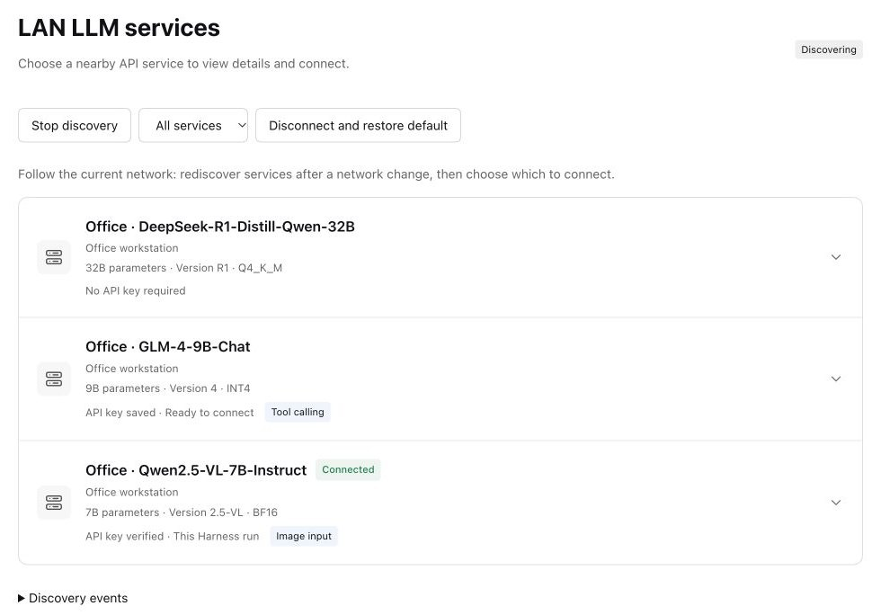

# LAN discovery for DeepSeek Harness

[中文](README.zh-CN.md) · [Website](https://nobrowning.github.io/llm-service-discovery-demo/) · [Full guide](https://github.com/nobrowning/dsh-lan-discovery/blob/main/docs/guide.md)

A plugin that adds a **LAN services** page to DeepSeek Harness. It lists the LLM APIs on the network you are on, like a Wi-Fi list, and connects the one you choose to a normal conversation.



## Why

Harness talks to models through an API, so it can work with any compatible LLM API server, including one on a workstation down the hall or on your desk at home. Using such a server today means typing its address into settings, and doing it again when the server moves or you join another network.

This plugin finds servers that announce themselves on the local network (service type `_llm-api._tcp`), shows them in a list, and follows your laptop from one network to the next.

## What you get

- **A list of nearby services**, showing the name, host and key status. Model size, version and abilities such as image input or tool calling appear once a service has been inspected.
- **You decide what connects.** Selecting a service does nothing on its own. Choose **Inspect service**, then **Connect and start chat**. For a service that needs a key, enter it and choose **Verify and connect**.
- **Clear key status**: *No API key required*, *API key saved* or *API key required*. A key can be saved through the Harness credential service or used for this session only.
- **Follows the network** (prerelease `0.6.0-roaming.1`). When you join another LAN, the old services are cleared and the new network's services appear. Saved keys stay, and your model does not change by itself.
- **Checked connections.** Before a key is sent, the plugin checks the certificate, host name, allowed addresses and auth policy against a local trust file.
- **English and Chinese**, following the Harness language setting.

## Requirements

- DeepSeek Harness Desktop **0.2.1-rc.3** or **0.2.1-rc.5** on Windows or macOS. Linux Web Host is still being evaluated.
- Services that announce `_llm-api._tcp` and implement the API described in the [service contract](https://github.com/nobrowning/dsh-lan-discovery/blob/main/docs/service-contract.md). Announcing an existing server does not by itself make it compatible.
- A trust file and, where needed, an API key from the service operator.

## Install

Download `dsh-lan-discovery-0.5.3.tgz` and `SHA256SUMS` from [Releases](https://github.com/nobrowning/dsh-lan-discovery/releases). Launch Harness once, quit it completely, then install with the CLI that ships inside Harness.

macOS:

```sh
dsh='/Applications/DeepSeek Harness.app/Contents/Resources/runtime/cli/bin/dsh'
"$dsh" plugin --profile desktop add "$PWD/dsh-lan-discovery-0.5.3.tgz"
```

Windows (PowerShell):

```powershell
$dsh = 'C:/path/to/DeepseekHarness/resources/runtime/cli/bin/dsh.cmd'
& $dsh plugin --profile desktop add (Resolve-Path './dsh-lan-discovery-0.5.3.tgz').Path
```

On macOS, allow **System Settings → Privacy & Security → Local Network → DeepSeek Harness**, or discovery cannot reach the network.

Following the network automatically (`interfaceMode: auto`) is part of the `0.6.0-roaming.1` prerelease, which is bundled with the [demo](https://github.com/nobrowning/llm-service-discovery-demo).

## Configure

Add the plugin settings to the Harness profile (`~/.dsh/profiles/desktop/cordis.patch.yml`), keeping the profile's other entries:

```yaml
- id: lan-discovery
  name: dsh-lan-discovery
  config:
    trustFile: '/Users/alice/llm-discovery/trust.json'
    interfaceMode: auto
    autoStart: true
```

With release `0.5.3`, use `interfaceAddress: '192.168.1.20'` (your LAN IPv4 address) instead of `interfaceMode: auto`. Then open **LAN services** in Harness. The trust file format and every option are in the [full guide](https://github.com/nobrowning/dsh-lan-discovery/blob/main/docs/guide.md#configure-and-connect).

## Learn more

- [Full guide](https://github.com/nobrowning/dsh-lan-discovery/blob/main/docs/guide.md): every platform, Linux Web Host, trust file, key handling, building from source.
- [Moving between networks](https://github.com/nobrowning/dsh-lan-discovery/blob/main/docs/roaming.md) and [behavior when the network or a service goes away](https://github.com/nobrowning/dsh-lan-discovery/blob/main/docs/stability.md).
- [Service contract](https://github.com/nobrowning/dsh-lan-discovery/blob/main/docs/service-contract.md) for people who run servers.
- [Platform support](https://github.com/nobrowning/dsh-lan-discovery/blob/main/docs/platform-support.md) and [integration notes](https://github.com/nobrowning/dsh-lan-discovery/blob/main/docs/integration-notes.md).

## Status

Experimental. It implements the discovery profile from the IETF Internet-Draft [draft-cui-dawn-local-llm-api-discovery-00](https://datatracker.ietf.org/doc/draft-cui-dawn-local-llm-api-discovery/) and a subset of Open Responses: text, local images, streaming, function calls and cancellation. The capability endpoint and the trust file are this project's own extensions.

## Part of Local LLM API Discovery

| Repository | What it does |
|---|---|
| [llm-api-advertiser](https://github.com/nobrowning/llm-api-advertiser) | Announces an LLM API on the local network. Runs next to the server. |
| [llm-discovery-core](https://github.com/nobrowning/llm-discovery-core) | Finds and checks announced services. A library for client apps. |
| **dsh-lan-discovery** (this repository) | Lists LAN services inside DeepSeek Harness and connects the one you choose. |
| [llm-service-discovery-demo](https://github.com/nobrowning/llm-service-discovery-demo) | Runnable demo with simulated APIs, and the project website. |

## Development

```sh
npm ci
npm run build
npm test
```

Edit `src/client.js` and `locale/*.json`, not the generated `client.js`.

## License

[MIT](LICENSE).
