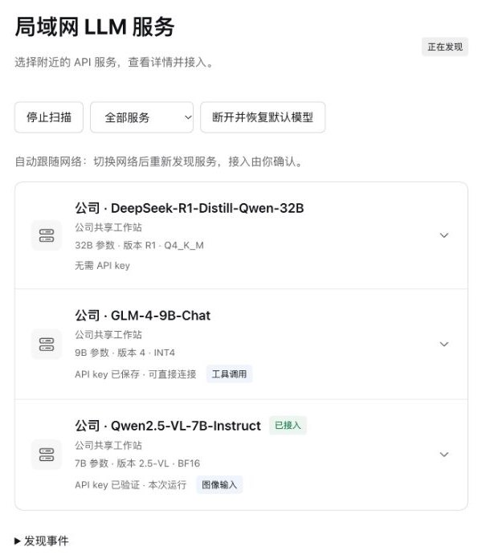

# DeepSeek Harness 局域网发现插件

[English](README.md) · [项目网站](https://nobrowning.github.io/llm-service-discovery-demo/?lang=zh) · [完整说明（英文）](https://github.com/nobrowning/dsh-lan-discovery/blob/main/docs/guide.md)

为 DeepSeek Harness 增加“局域网服务”页面的插件。它像 Wi-Fi 列表一样列出当前网络中的 LLM API，并把你选择的服务接入正常对话。



## 为什么需要

Harness 通过 API 调用模型，所以它可以使用任何兼容的 LLM API server，包括隔壁办公室的工作站，或家里桌上的电脑。但现在要用这样的 server，就得把地址手动填进设置；server 换了地址，或者你换了网络，又得重新填。

这个插件会发现在局域网中公告自己的服务（服务类型 `_llm-api._tcp`），把它们列出来，并在笔记本从一个网络换到另一个网络时自动跟随。

## 功能

- **附近服务列表**：显示名称、主机和 key 状态。检查服务之后，还会显示模型规模、版本，以及图像输入、工具调用等能力。
- **由你决定接入哪个。** 选中服务不会触发任何操作。点击“检查服务”，再点击“连接并新建会话”。需要 key 的服务，输入 key 后点击“验证并连接”。
- **清楚的 key 状态**：“无需 API key”“API key 已保存”或“需要 API key”。key 可以通过 Harness 凭据服务保存，也可以只在本次运行中使用。
- **跟随网络**（预发布版本 `0.6.0-roaming.1`）。接入另一个局域网时，旧服务被清除，出现新网络的服务。已保存的 key 不受影响，你正在用的模型也不会自动更换。
- **连接经过校验。** 发送 key 之前，插件会按本地信任文件检查证书、主机名、允许的地址和认证策略。
- **中英文界面**，跟随 Harness 的语言设置。

## 使用条件

- Windows 或 macOS 上的 DeepSeek Harness Desktop **0.2.1-rc.3** 或 **0.2.1-rc.5**。Linux Web Host 仍在评估中。
- 服务需公告 `_llm-api._tcp`，并实现[服务接口约定](https://github.com/nobrowning/dsh-lan-discovery/blob/main/docs/service-contract.md)中的 API。仅仅给已有服务加上公告，并不能让它自动兼容。
- 由服务运营者提供的信任文件，以及（如需要）API key。

## 安装

从 [Releases](https://github.com/nobrowning/dsh-lan-discovery/releases) 下载 `dsh-lan-discovery-0.5.3.tgz` 和 `SHA256SUMS`。先启动一次 Harness，再完全退出，然后用 Harness 自带的命令行工具安装。

macOS：

```sh
dsh='/Applications/DeepSeek Harness.app/Contents/Resources/runtime/cli/bin/dsh'
"$dsh" plugin --profile desktop add "$PWD/dsh-lan-discovery-0.5.3.tgz"
```

Windows（PowerShell）：

```powershell
$dsh = 'C:/path/to/DeepseekHarness/resources/runtime/cli/bin/dsh.cmd'
& $dsh plugin --profile desktop add (Resolve-Path './dsh-lan-discovery-0.5.3.tgz').Path
```

在 macOS 上，需要在“系统设置 → 隐私与安全性 → 本地网络 → DeepSeek Harness”中允许访问，否则无法发现服务。

自动跟随网络（`interfaceMode: auto`）属于 `0.6.0-roaming.1` 预发布版本，已随 [Demo](https://github.com/nobrowning/llm-service-discovery-demo) 一起提供。

## 配置

在 Harness 配置文件（`~/.dsh/profiles/desktop/cordis.patch.yml`）中加入插件设置，保留其中原有的其他条目：

```yaml
- id: lan-discovery
  name: dsh-lan-discovery
  config:
    trustFile: '/Users/alice/llm-discovery/trust.json'
    interfaceMode: auto
    autoStart: true
```

使用 `0.5.3` 正式版时，请把 `interfaceMode: auto` 换成 `interfaceAddress: '192.168.1.20'`（本机的局域网 IPv4 地址）。然后在 Harness 中打开“局域网服务”。信任文件格式和全部选项见[完整说明](https://github.com/nobrowning/dsh-lan-discovery/blob/main/docs/guide.md#configure-and-connect)。

## 更多

- [完整说明（英文）](https://github.com/nobrowning/dsh-lan-discovery/blob/main/docs/guide.md)：各平台安装、Linux Web Host、信任文件、key 管理、从源码构建。
- [在不同网络之间切换](https://github.com/nobrowning/dsh-lan-discovery/blob/main/docs/roaming.md)（文末有中文摘要），以及[网络或服务中断时的行为](https://github.com/nobrowning/dsh-lan-discovery/blob/main/docs/stability.md)。
- 面向服务运营者的[服务接口约定](https://github.com/nobrowning/dsh-lan-discovery/blob/main/docs/service-contract.md)。
- [平台支持](https://github.com/nobrowning/dsh-lan-discovery/blob/main/docs/platform-support.md)与[集成说明](https://github.com/nobrowning/dsh-lan-discovery/blob/main/docs/integration-notes.md)。

## 项目状态

实验性项目。实现了 IETF 互联网草案 [draft-cui-dawn-local-llm-api-discovery-00](https://datatracker.ietf.org/doc/draft-cui-dawn-local-llm-api-discovery/) 中的发现规范，以及 Open Responses 的一个子集：文本、本地图片、流式输出、函数调用和取消请求。能力信息接口和信任文件是本项目自己的扩展。

## 所属项目：局域网 LLM API 发现

| 仓库 | 作用 |
|---|---|
| [llm-api-advertiser](https://github.com/nobrowning/llm-api-advertiser) | 在局域网中公告 LLM API，运行在服务端旁边。 |
| [llm-discovery-core](https://github.com/nobrowning/llm-discovery-core) | 发现并校验公告的服务，供客户端应用使用的库。 |
| **dsh-lan-discovery**（本仓库） | 在 DeepSeek Harness 中列出局域网服务，并接入你选择的那个。 |
| [llm-service-discovery-demo](https://github.com/nobrowning/llm-service-discovery-demo) | 使用模拟 API 的可运行 Demo，以及项目网站。 |

## 开发

```sh
npm ci
npm run build
npm test
```

请修改 `src/client.js` 和 `locale/*.json`，不要直接修改生成的 `client.js`。

## 许可

[MIT](LICENSE)。
